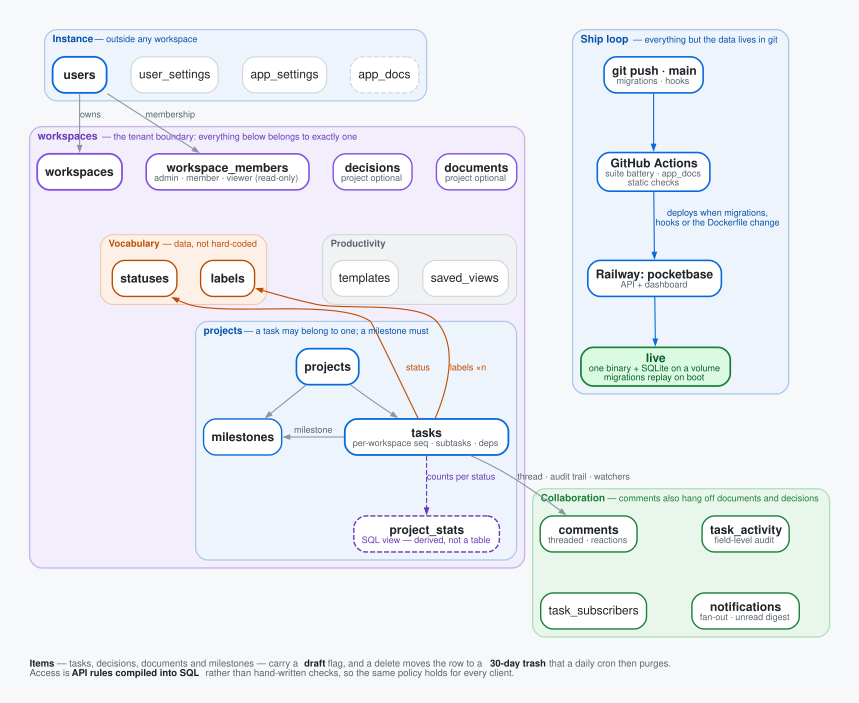

# Task Tracker

A multi-workspace task tracker backend, built on
[PocketBase](https://pocketbase.io) — a complete REST API with almost no backend
code.



- **A real collaboration model, not a to-do list** — workspaces with
  owner/admin/member roles, projects, tasks with per-workspace sequence numbers,
  plus decisions, documents and milestones.
- **Built to collaborate on** — threaded comments with reactions, a field-level
  activity audit trail, task subscriptions, and fan-out notifications with an
  unread digest.
- **Customisable vocabulary** — labels and statuses are first-class per-workspace
  collections, seeded with sensible defaults, so teams rename and extend them
  without a schema change.
- **Safe by default** — access policy is API rules compiled into SQL rather than
  hand-written checks, and deletes go to a 30-day trash instead of vanishing.
- **Reproducible from git alone** — clone and the migrations rebuild everything;
  push and CI plus Railway deploy it. The database is the only thing not in git.


The screen above is the app running against the sample data `scripts/seed.ts`
creates, so `make dev` gets you there in one command.

## Quick start

The `pocketbase` binary, `pb_data/` and `.env` are gitignored, so a fresh clone
builds the backend rather than inheriting one:

```bash
# Install mise first, then trust this checkout's reviewed runtime pins.
mise trust
make setup                 # runtimes (incl. Lefthook), npm ci, PocketBase and local config
git config extensions.worktreeConfig true && git config --worktree core.hooksPath .githooks   # once per checkout: pre-commit runs lefthook.yml; fails if Lefthook is missing
# Repeat in each checkout/worktree; existing config and pb_data survive.
make dev                  # web + PocketBase, seeds a fresh database
```

`make dev` needs no hand setup, in a clone or a worktree: it writes a local `.env`
with a fictitious dashboard superuser when none exists, creates that superuser before
PocketBase first starts, and runs the binary `PB_BIN` names, else this checkout's
`./pocketbase`, else the main checkout's, downloading the pinned version when none of the
last two is that version (a `PB_BIN` that is not is refused, never downloaded over).

Signing up provisions a workspace, a membership, a default project and the
starter label and status sets automatically.

## Building against it

[`openapi.json`](openapi.json) is the API contract, generated from the
migrations and gated against drift on every commit — it is never hand-edited.
[`docs/generated/decisions.md`](docs/generated/decisions.md) records the product and schema rulings
behind it, generated the same way.

## Verify

The gate runners select the Bun and Node versions pinned in `mise.toml`.
For individual commands, activate the same environment first:

```bash
. scripts/verification-env.sh
bash scripts/run_suite_battery.sh   # the whole battery — what CI runs
bun tests/test_rules.ts         # one suite (any tests/test_*.ts runs solo)
```

Each suite boots its own clean server, probes the full role matrix, and exits
non-zero on any failure. On macOS the battery retries a suite once if its
connection drops mid-run (a local file-watcher artifact); CI is unaffected.

CI splits the battery across four runners by `scripts/battery_shards.tsv`, and a verify job
fails when any suite ran in no shard. `make battery` and `make dod` run it whole.

## Configuration

Two layers, each with a tracked `.example` sibling and a gitignored real file:

| File | Purpose | Read by |
| --- | --- | --- |
| `.env` | deployment config, mirrors the Railway service variables; locally, the dev superuser `make env` writes | the `pb_hooks/` env boot hooks, the Dockerfile, `make dev` |
| `.env.local` | local-testing overrides — ports, paths, mail sink | `scripts/`, `tests/` |
| `web/.env.local` | the web app's own dev vars | Next.js |

## Layout

- `pb_migrations/` — the schema source of truth. `schema/` — generated
  per-collection docs (`scripts/gen_schema.ts`). `pb_hooks/` — validation,
  lifecycle and custom routes.
- `scripts/` — dev tooling and the generators. `tests/` — end-to-end proofs.
- `web/` — the Next.js app, deployed as its own service and talking to PocketBase
  through a proxy seam.
- [`deploy/`](deploy/README.md) — local Docker stacks, Railway configuration and deployment recipes.
Tasks, decisions and planning docs live on the kata board, not in this repo.

## History

This repo began as a hands-on PocketBase course. That material — twenty-one
modules with their own README — is preserved on the
[`learning`](../../tree/learning) branch.
